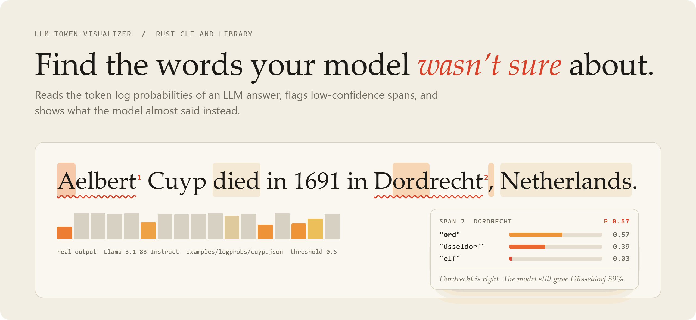

# LLM Hallucination Detector

English | [简体中文](README.zh-CN.md) | [日本語](README.ja.md) | [한국어](README.ko.md)

[](https://crates.io/crates/llm-token-visualizer)

Shows which words of an AI answer to double-check.

No second LLM call. Flags a 4,000-token answer in 9.0 ms.

<picture>
  <source media="(prefers-color-scheme: dark)" srcset="docs/assets/hero-dark.png">
  
</picture>

- Reads the model's own token logprobs.
- Highlights the words it was unsure about.
- Shows what it almost said instead.
- Outputs terminal, HTML, Markdown or JSON.
- Fails CI with `--fail-on-flag`.

## Install

```sh
cargo install --locked llm-token-visualizer
```

No Rust? [Download for Windows (.exe)](https://gitlab.com/mattbusel/LLM-Hallucination-Detection-Script/-/releases/permalink/latest/downloads/llm-token-visualizer-windows-x86_64.exe).

## Use

```sh
llm-token-visualizer --logprobs-file answer.json --threshold 0.6
```

[Reference](docs/REFERENCE.md) · [docs.rs](https://docs.rs/llm-token-visualizer) · [Site](https://hallucination-highlighter.vercel.app/) · [Releases](https://gitlab.com/mattbusel/LLM-Hallucination-Detection-Script/-/releases)

License: MIT, see [LICENSE](LICENSE).

More: [docs/DETAILS.md](docs/DETAILS.md)
