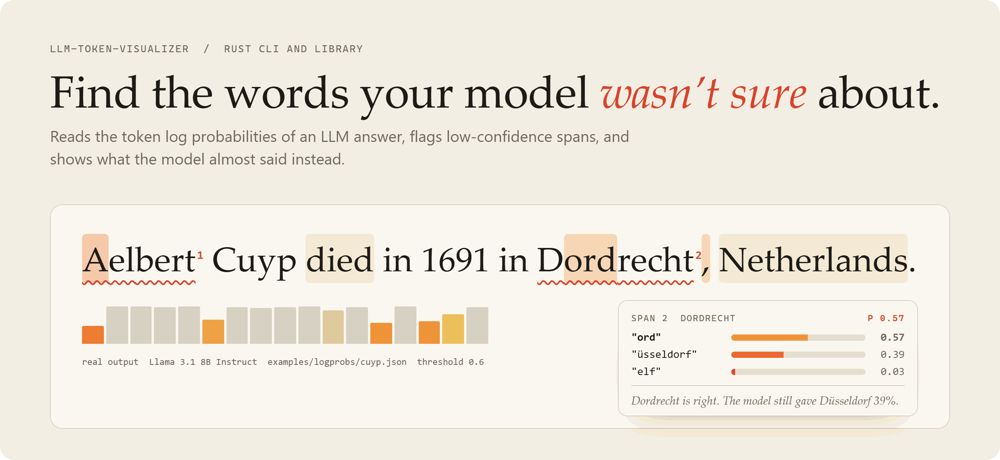
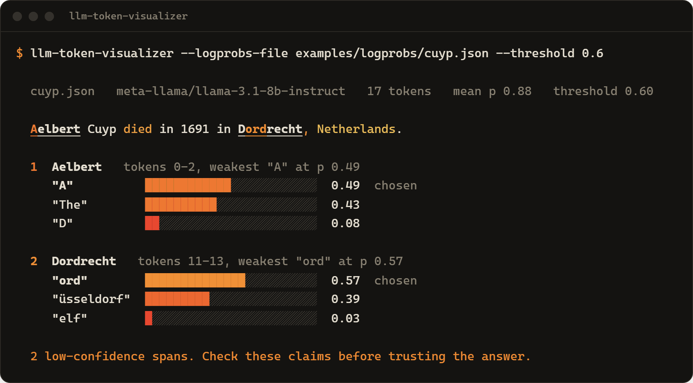
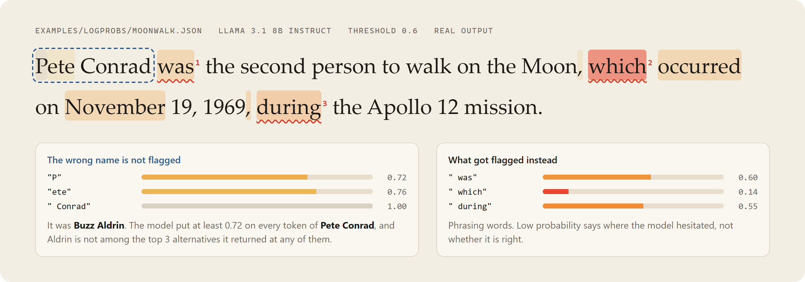

# LLM Hallucination Detector: details

The full README before it was cut down. Back to the [short README](../README.md).

---

# LLM Hallucination Detector

<!-- outcome-block -->
**Shows which words of an AI answer to double-check. Every word the model was unsure about gets highlighted, in any language.**

It reads the model's own token probabilities. No second LLM call, no extra cost.

If it doesn't do what this README says, [open an issue](https://github.com/Mattbusel/LLM-Hallucination-Detection-Script/issues) and I'll fix it.
<!-- outcome-block -->

English | [简体中文](../README.zh-CN.md) | [日本語](../README.ja.md) | [한국어](../README.ko.md)

Rust CLI and library (`llm-token-visualizer`). Works with OpenAI, OpenRouter, Together, vLLM, Ollama and any OpenAI-compatible API that returns token logprobs.

Works in any language. Words are split with Unicode word segmentation, so one unsure character in a Chinese or Japanese answer gets flagged on its own. Reads OpenAI-style, completions-style and Google Gemini (`logprobsResult`) responses.

<picture>
  <source media="(prefers-color-scheme: dark)" srcset="assets/hero-dark.png">
  
</picture>

<p align="center">
  <a href="https://crates.io/crates/llm-token-visualizer"></a>
</p>

## Install

**Linux** (x86_64, Ubuntu 20.04+ / Debian 11+). One line, no dependencies, installs to `~/.local/bin`:

```sh
mkdir -p ~/.local/bin && curl -fsSL https://gitlab.com/mattbusel/LLM-Hallucination-Detection-Script/-/releases/permalink/latest/downloads/llm-token-visualizer-linux-x86_64.tar.gz | tar xz --strip-components=1 -C ~/.local/bin --wildcards '*/llm-token-visualizer'
```

| Other systems | |
|---|---|
| **Windows** | [Download llm-token-visualizer-windows-x86_64.exe](https://gitlab.com/mattbusel/LLM-Hallucination-Detection-Script/-/releases/permalink/latest/downloads/llm-token-visualizer-windows-x86_64.exe) and run it. (Unsigned, so SmartScreen may ask: *More info*, then *Run anyway*.) |
| **Any system with Rust** | `cargo binstall llm-token-visualizer` (prebuilt Linux and Windows binaries) or `cargo install --locked llm-token-visualizer` |
| **As a library** | `cargo add llm-token-visualizer --no-default-features` (no HTTP client) |

Release archives include the sample answers under `samples/`. All releases, with SHA-256 checksums: [Releases](https://gitlab.com/mattbusel/LLM-Hallucination-Detection-Script/-/releases).

**In GitLab CI:** the [`hallucination-gate`](https://gitlab.com/explore/catalog/mattbusel/llm-ci) component fails a pipeline when a saved LLM answer has low-confidence words.

## How it works



A model picks each token (a word or part of a word) from a list of options, each with a probability. APIs return these as `logprobs`. Hallucinations often sit where that probability drops: a name, a date, a city the model half-remembers. This tool turns the numbers into a heatmap, flags the shaky words, and shows what the model almost said instead. It has no model of its own. It makes no API calls unless you ask for `--live`.

## Examples

Real Llama 3.1 8B Instruct answers, bundled in `examples/logprobs/`. First two of four from `cargo run --example detect` (threshold 0.6):

```text
examples/logprobs/cuyp.json
  answer: Aelbert Cuyp died in 1691 in Dordrecht, Netherlands.
  flagged "Aelbert": p=0.49 at "A"; model also considered "The" (0.43), "D" (0.08)
  flagged "Dordrecht": p=0.57 at "ord"; model also considered "üsseldorf" (0.39), "elf" (0.03)

examples/logprobs/tour-de-france.json
  answer: Stephen Roche won the 1987 Tour de France, riding for the Carrera Jeans-Vagabond team.
  flagged "Stephen": p=0.49 at "Stephen"; model also considered "The" (0.43), "Steven" (0.03)
  flagged "-Vagabond": p=0.57 at "-V"; model also considered "–" (0.21), " -" (0.14)
```

Dordrecht is right, but the model gave Düsseldorf a 39% chance. That is the kind of claim to double-check. The "Aelbert" flag is the model choosing between the name and "The". Low probability can be about wording, not facts.

Terminal report for the first one (`--logprobs-file examples/logprobs/cuyp.json --threshold 0.6`):



### What it cannot tell you

<picture>
  <source media="(prefers-color-scheme: dark)" srcset="assets/confidently-wrong-dark.png">
  
</picture>

Models can be confidently wrong. In `moonwalk.json` the model says "Pete Conrad was the second person to walk on the Moon" (it was Buzz Aldrin). Every token of the name is at 72% or higher, so it is not flagged. Use this to pick where to look first, not to prove an answer right.

## Why this tool

No other Rust crate does logprob-based confidence checks. In Python, [LM-Polygraph](https://github.com/IINemo/lm-polygraph) and [UQLM](https://github.com/cvs-health/uqlm) have many more methods (sampling consistency, claim-level scoring, trained estimators). They need the model loaded or several generations per answer. This tool does one cheap thing from one saved response: shows the low-probability words and what else the model considered. Output as a terminal heatmap, HTML page, Markdown for a merge request, JSON, or a CI exit code. Each report gives the answer's perplexity. Each flagged span gives the entropy of the options at its weakest token.

## Use it in 3 steps

1. **Get a response with logprobs.** Ask your API for `"logprobs": true, "top_logprobs": 3` and save the JSON. Or set `OPENAI_API_KEY` and run `llm-token-visualizer --live "your question" --save answer.json`.
2. **Run it:** `llm-token-visualizer --logprobs-file answer.json --threshold 0.6`
3. **Share or gate it:** `--format html -o report.html` for a page to send, `--format markdown` for a PR comment, `--fail-on-flag` to fail a CI job when anything is flagged.

## Providers

`--live` asks a model and checks its answer. Pick the provider with `--provider` (default `openai`). Change the address with `--base-url`:

| `--provider` | Default base URL | Key from | Default `--model` | How it was checked |
|---|---|---|---|---|
| `openai` | `https://api.openai.com/v1` (or `OPENAI_BASE_URL`) | `OPENAI_API_KEY` | `gpt-4o-mini` | Docs (`logprobs`, `top_logprobs` up to 5). Request building unit-tested. |
| `openrouter` | `https://openrouter.ai/api/v1` | `OPENROUTER_API_KEY` | `openai/gpt-4o-mini` | Docs (`logprobs`, `top_logprobs`; support depends on the upstream provider, so the request sets `provider.require_parameters`). Request building unit-tested. |
| `together` | `https://api.together.ai/v1` | `TOGETHER_API_KEY` | none, pass `--model` | Docs (Together takes `"logprobs": <int>` rather than `true`, and the CLI sends that). Request building unit-tested. |
| `vllm` | `http://localhost:8000/v1` | `VLLM_API_KEY`, only if the server uses `--api-key` | none, pass `--model` | Docs (`logprobs`, `top_logprobs` in Chat Completions). Request building unit-tested. |
| `ollama` | `http://localhost:11434/v1` | no key | none, pass `--model` | **Real call** to Ollama 0.34.4 with `qwen2.5-coder:14b`: logprobs and top 3 alternatives came back. (Ollama's own OpenAI-compatibility page still lists logprobs as unsupported; older versions may not return them.) |

```sh
llm-token-visualizer --live "Who painted The Night Watch?" --provider ollama --model qwen2.5-coder:14b
llm-token-visualizer --live "Who painted The Night Watch?" --provider openrouter --save answer.json
llm-token-visualizer --live "..." --provider vllm --model my-model --base-url http://gpu-box:8000/v1
```

No hosted provider was called with a real key for this release. If an answer comes back without logprobs, the CLI stops with an error that says so and shows the answer. Anthropic's API does not return logprobs, so it has no preset.

Google Gemini's native API also returns logprobs (`generationConfig: {responseLogprobs: true, logprobs: 3}`). Save the response and pass it with `--logprobs-file`.

No API key? Grab a sample: `curl -LO https://gitlab.com/mattbusel/LLM-Hallucination-Detection-Script/-/raw/main/examples/logprobs/cuyp.json`

## Library

```rust
use llm_token_visualizer::detect::{detect, parse_logprobs};

let json = std::fs::read_to_string("examples/logprobs/cuyp.json")?;
let report = detect(&parse_logprobs(&json)?, 0.6);
for span in &report.spans {
    println!("{:?}: {}", span.text.trim(), span.describe());
}
println!("perplexity {:.2}", report.perplexity);
# Ok::<(), anyhow::Error>(())
```

| Feature | Default | What it adds |
|---|---|---|
| `live` | on | `--live` and the `live` module: asks an OpenAI-compatible API (ureq, rustls; 120 s timeout) |
| `async-openai` | off | `interop::async_openai::tokens_from_response` for `async_openai` chat completion responses (types only, no HTTP client) |

Examples (`cargo run --example <name>`): `detect` (every bundled sample), `ci_gate` (a directory of answers, exit 2 when any is flagged), `html_report` (write the HTML page for one answer).

Using **async-openai**? Turn on the feature, pass your `CreateChatCompletionResponse` to `interop::async_openai::tokens_from_response`, then `detect`. Another client? Turn its response into JSON and call `parse_logprobs`.

## Performance

`cargo bench --bench vs_0_4` parses a 4,000-token response and flags spans: 9.0 ms on 0.5.0, 14.6 ms on 0.4.0 (criterion medians, i7-13700KF, Windows 11, Rust 1.91). 0.5.0 reads the logprobs without copying the JSON first. That saves more than the Unicode word segmentation costs.

## Documentation

| | |
|---|---|
| [Reference](REFERENCE.md) | Every flag, output formats (terminal, HTML, Markdown, JSON), CI use, input formats, live mode, your own confidence scores, library API |
| [How it works and repo layout](ARCHITECTURE.md) | The detection rules and color scale in detail, source layout, what is a sketch and what ships |
| [API docs on docs.rs](https://docs.rs/llm-token-visualizer) | The Rust library |
| [Project site](https://hallucination-highlighter.vercel.app/) | Overview |
| [Browser version (source)](try/index.html) | The samples with a threshold slider, or ask a provider with your own key; open the file from a clone |
| [Changelog](../CHANGELOG.md) | What changed in each release |

## License

MIT, see [LICENSE](../LICENSE).
